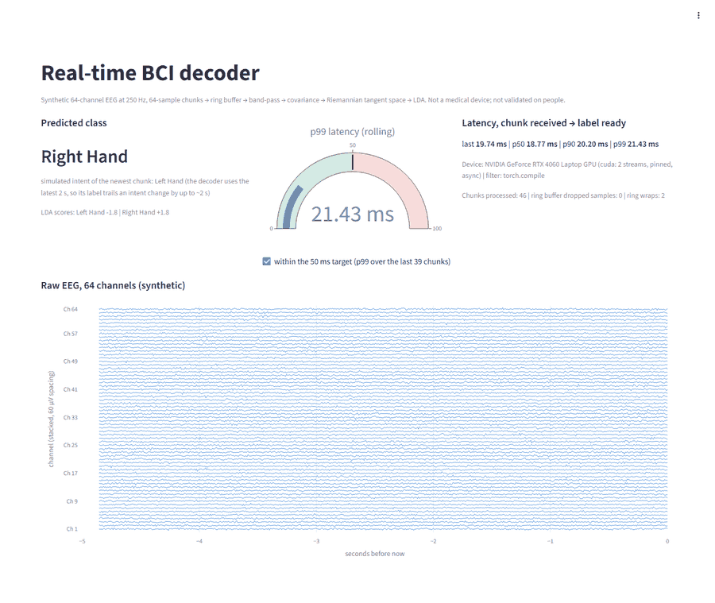
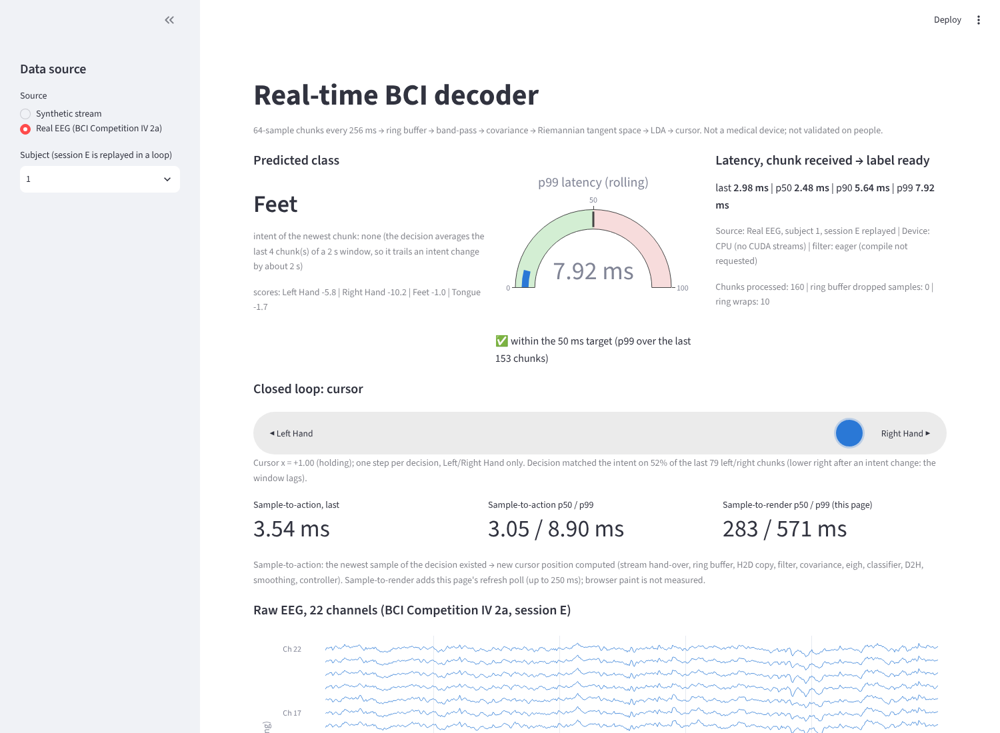

# realtime-bci

A real-time, GPU-accelerated EEG decoding pipeline, benchmarked on a **synthetic** 64-channel stream and
evaluated on the public BCI Competition IV 2a recordings (below). A stream goes through a CPU ring buffer
into pinned memory, then onto the GPU (two CUDA streams) for band-pass filtering, covariance, a Riemannian
tangent-space map and an LDA classifier. A Streamlit dashboard shows the raw EEG, the predicted class, a
cursor driven by the decisions and a live p99-latency gauge.

## What this is / what this is NOT

**This is** a streaming-systems demonstration: ring buffer, pinned-memory transfers, CUDA
streams, a `torch.compile`d vectorized filter, CPU/GPU correctness tests, an ONNX parity check,
and a latency benchmark that measures from "chunk received" to "label ready".

**This is not** a hardware-validated BCI. It has never seen a real EEG amplifier or a person. The
latency benchmark uses synthetic data (accuracy on that generator, 0.865 held-out, says nothing about
real EEG); the real-data results below come from a public dataset, replayed, with no artifact removal.

## Latency (measured)

**p99 = 23.4 ms** end to end, chunk received → label ready, at real-time rate (one 256 ms chunk
every 256 ms), target < 50 ms. NVIDIA GeForce RTX 4060 Laptop GPU, Windows, torch 2.10.0+cu128,
1000 measured chunks after 50 discarded warm-up chunks.

| run (1000 chunks) | p50 | p90 | **p99** | max |
|---|---|---|---|---|
| `paced`: real-time rate, 2 streams, pinned | 18.61 ms | 20.65 ms | **23.42 ms** | 26.97 ms |
| `overlap`: back-to-back, look-ahead | 7.84 ms | 8.76 ms | 11.22 ms | 14.18 ms |
| `baseline`: back-to-back, 1 stream, blocking | 3.86 ms | 4.34 ms | 5.19 ms | 6.63 ms |

Sources: `results/benchmark_summary.csv`, per-chunk raw data `results/benchmark_latency*.csv`,
histogram `results/latency_histogram.png`. Stage breakdown, the profiler trace and everything that
did not go as hoped are in [FINDINGS.md](FINDINGS.md); every claim and how it was verified is in
[CLAIMS.md](CLAIMS.md).

Two things to know before quoting these numbers:
* The classifier stage (a float64 `eigh` plus its documented host sync) is ~75% of the compute
  time. The CUDA stream overlap is real but tiny (7 µs of an 11 µs copy overlapped a kernel) and
  **did not reduce latency**: the look-ahead variant is slower than the plain baseline.
* Back-to-back runs flatter the pipeline; the paced run is the realistic one. Numbers come from one
  laptop with other applications open and vary ~10% run to run.

## Dashboard



*Recorded on the RTX 4060 laptop, before the closed-loop view was added: the page shows the device and a live rolling p99.* The decoder
uses the latest 2 s of data, so its label trails a change of simulated intent by up to ~2 s.

## Real EEG (BCI Competition IV 2a) and LSL

The same pipeline decodes the real **BCI Competition IV 2a** motor-imagery dataset (9 subjects, 4 classes,
22 EEG channels, loaded with MOABB) streamed through **Lab Streaming Layer** from a separate producer process.
Per subject: train on session T, stream session E, score on the experts' artifact-free trials.

| | accuracy | Cohen's kappa |
|---|---|---|
| this pipeline, fixed window (deployable) | 0.629 | **0.505** |
| this pipeline, best time point (competition-style) | | 0.523 |
| first version of this pipeline (no smoothing), fixed window / best time point | 0.592 | 0.456 / 0.510 |
| 2008 competition winner (Ang et al., FBCSP) | | 0.57 |

The decoder is an 8–30 Hz band, a 2 s window and a mean over the last 4 chunk scores. That smoothing was
chosen by cross-validation on session T only (24 candidates, `python -m bci.real_benchmark select`); session E
was scored once with it.

**It still does not beat the winner** (0.065 below at the fixed window, 0.047 at the best time point). It is at or above it on S1, S6 and S9, far below on S2, S3, S5, S7, S8, and the
two sets of per-subject kappas correlate at r = 0.91. The comparison is approximate (the competition scored a
sample-by-sample causal output and took the best time point). BCI Competition IV was held in **2008**.
Artifacts are logged, not removed (no ICA): 8.6% of evaluation trials are expert-flagged and decode at 0.59
accuracy vs 0.63 for clean trials (0.52 vs 0.60 before smoothing). Detail, per-subject tables and caveats:
[FINDINGS.md](FINDINGS.md) §6 (first version) and §8 (selected decoder), figure `results/real/kappa_vs_competition.png`.

**On the RTX 4060 laptop** (real recordings arriving through LSL from a separate process, 1× real time, five
runs of 1000 chunks): **median label latency 7.1–7.3 ms; p99 10.2–26.0 ms** (target 50 ms, met in every run; the
slowest single chunk was 87.7 ms once) and **LSL jitter 0.05–0.07 ms** (std of producer timestamp → ring buffer
delay; limit 1 ms). The p99 varies between runs for a reason I did not isolate (about 1–2% of chunks run 4× slower
in the covariance and classifier stages in the three high-p99 runs; FINDINGS §7.1), so don't quote one number.
The 0.505 / 0.523 kappa and the accuracy above were reproduced on the GPU (identical output; the first version's
were byte-identical on both machines too). Loopback only: no network jitter. These are compute
latencies; the decoder's 2 s window means a label trails the user's intent by about two seconds.

```bash
pip install -e ".[dev]"                       # includes moabb + pylsl
make benchmark-real                           # 9-subject accuracy/kappa (smoothing k=4), then real-data latency + LSL jitter (GPU) -> results/real/
python -m bci.real_benchmark select           # the session-T-only choice of the decoder (about 4 min on 4 cores; never loads session E)
make test-real                                # also runs the tests that download the dataset (~80 MB per subject)
```

## Closed-loop dashboard

`make dashboard` now shows a cursor that moves left/right with the decoded class (*Left Hand* −0.1, *Right Hand* +0.1 per
decision, other classes hold, clipped at ±1), the live agreement with the intent, and **sample-to-action latency**:
from the moment the newest sample of a decision existed (chunk complete) to the moment the new cursor position was
computed. The sidebar switches between the synthetic stream and the real recordings (subject 1–9, session E replayed in a
loop; needs `pip install -e ".[real]"` for MOABB).



*Container, CPU device, real subject 1.* What is and is not established (FINDINGS §8.3, CLAIMS P18–P23):
* Sample-to-action on the **RTX 4060** (real subject 1, one 180 s run, newest 500 decisions): **p50 7.6 ms, p90 9.4 ms,
  p99 19.2 ms**, of which the action step itself adds 0.4–0.5 ms. The CPU screenshots read p50 / p99 3.05 / 8.90 ms
  (real) and 4.66 / 16.40 ms (synthetic), one readout each. Sample-to-render also includes the ≤ 250 ms page poll;
  the browser's paint is not measured.
* Sample-to-action excludes the window: a label trails the user's intent by about 2 s plus 0.4 s of smoothing delay.
* The cursor is an integrator and is pinned at +1.00 in the screenshot: it shows the decoder's direction, not a
  calibrated control signal. The 52% intent agreement shown there is a short rolling window, not an accuracy.

## Quick start

On a machine with an NVIDIA GPU, **first** install a CUDA build of PyTorch (the default PyPI wheel
on Windows is CPU-only; GPU tests then fail by design instead of silently skipping). The stack this
repo was measured and tested on (Windows, Python 3.13):

```powershell
pip install torch==2.10.0 --index-url https://download.pytorch.org/whl/cu128
pip install -e ".[dev]"
pip install "triton-windows<3.7"     # lets torch.compile run on Windows; without it the filter falls back to eager
python -m playwright install chromium
```

Keep CUDA builds matched: `onnxruntime-gpu` 1.27+ is built for CUDA 13 and cannot load next to a
CUDA 12.x torch (`pyproject.toml` pins the 1.21–1.26 series, built for CUDA 12.8). `triton-windows`
3.6 is the series the triton-windows docs pair with torch 2.10; I found no mapping for newer torch.
On Linux, Triton ships with the CUDA torch wheels.

```bash
make install     # pip install -e ".[dev]" + playwright chromium
make test        # pytest; GPU tests FAIL (not skip) without CUDA. Use `make test REQUIRE_CUDA=0` on CPU.
make benchmark   # overlap + baseline + paced runs, 1000 measured chunks each -> results/benchmark_*.csv, latency_histogram.png (~6 min; SKIP_PACED=1 omits the real-time run)
make dashboard   # streamlit run app/dashboard.py
make profile     # torch.profiler -> results/profiler_trace.json, profiler_overlap.png, profiler_overlap.csv
```

`make` and `scripts/run_benchmark.sh` need a POSIX shell. On Windows PowerShell the same things are:

```powershell
$env:BCI_REQUIRE_CUDA = "1"; python -m pytest -v -rs
python -m bci.gpu_pipeline benchmark --chunks 1000 --warmup 50 --runs overlap,baseline,paced --out-dir results
python scripts\profile.py --out-dir results
python -m streamlit run app\dashboard.py
```

The `paced` run takes about 4.5 minutes. Before benchmarking: plug in AC power and close other
GPU-heavy applications.

## How it works

```
SyntheticEEGStream ──64×64 chunk──▶ RingBuffer (1000×64, O(1) writes)
                                        │ latest 500 samples, copied straight into a pinned slot
                                        ▼
             copy stream:   H2D (non_blocking) ─ event ─┐
             compute stream:                            └▶ FIR band-pass → covariance → eigh/log → LDA ─ event ─▶ D2H
                                                                                                                  │
                                                                              label + scores in pinned memory ◀──┘
```

* **Look-ahead:** the host enqueues chunk *N-1*'s filter/covariance kernels, then stages chunk *N*
  (pinned copy + async H2D), then runs *N-1*'s `eigh` + classifier. Slot reuse is guarded by CUDA
  events, not host syncs. Measured effect: see above (none on latency).
* **Hot path has no `.item()`, `.cuda()`, `.cpu()`, `.tolist()` or `print`**, enforced by an AST
  test. One host synchronization is unavoidable: `torch.linalg.eigh` on CUDA synchronizes with the
  CPU (PyTorch documents it). It follows from choosing a Riemannian classifier.
* **Precision:** TF32 is disabled (PyTorch leaves cuDNN TF32 on by default); the filter runs in
  float32, covariance/`eigh`/LDA in float64. CUDA output matches scipy float64 to ≤ 1.2e-5
  (requirement 1e-4).
* **Filter:** one `conv1d` over all 64 channels (channels folded into the batch axis).
  `torch.compile` is attempted on CUDA; if Triton or a compiler is missing it falls back to eager
  and the result files say `filter_compiled=False`. On the measured machine compiling it made no
  measurable difference.
* **Dashboard:** the pipeline runs in its own process so Streamlit's rendering cannot stall it.
* **ONNX:** the LDA head is exported and run in onnxruntime (CUDA provider). The eigendecomposition
  step is not exportable (`aten::linalg_eigh` unsupported), so the full model is not.

Details and every decision: [SPEC.md](SPEC.md).

## Layout

```
src/bci/    stream.py ring_buffer.py filters.py classifier.py gpu_pipeline.py server.py lsl_stream.py real_benchmark.py closed_loop.py
app/        dashboard.py            Streamlit UI (Hugging Face Spaces entry point)
tests/      test_ring_buffer.py test_correctness.py test_latency.py test_dashboard.py test_server.py test_profile_analysis.py test_real_stream.py test_lsl.py test_closed_loop.py
scripts/    run_benchmark.sh profile.py record_gif.py ui_contention.py
results/    benchmark_*.csv, latency_histogram.png, profiler_*, dashboard_demo.gif   (from the GPU run)
            real/  selected-decoder accuracy/kappa/noise log/chart + model_selection_T.csv (container CPU run), baseline_k1/ (first version), real latency (GPU run)
            closed_loop_*_cpu.png  dashboard screenshots (container)
gpu_run/    extra GPU runs (eager-filter A/B);  gpu_*.txt in the root: console logs of the GPU runs (UTF-16)
```

## Deploy the dashboard to Hugging Face Spaces

The front-matter at the top of this file declares a Streamlit Space with `app/dashboard.py` as the
entry point; `requirements.txt` lists the runtime dependencies (CPU torch). Push the repo to a
Space; no code changes are needed. A free CPU Space runs the same pipeline on CPU and says
"Device: CPU" on the page. For a GPU Space delete the first line of `requirements.txt` (the CPU
index). **Not deployed or tested on Spaces** (see CLAIMS.md C4).

## Limitations

The latency benchmark is on synthetic data; real-data results are a replay of one public dataset; no artifact removal; the dashboard assumes an ideal network; one laptop and
one software stack were measured; Docker, CI and Hugging Face deployment were never run.
