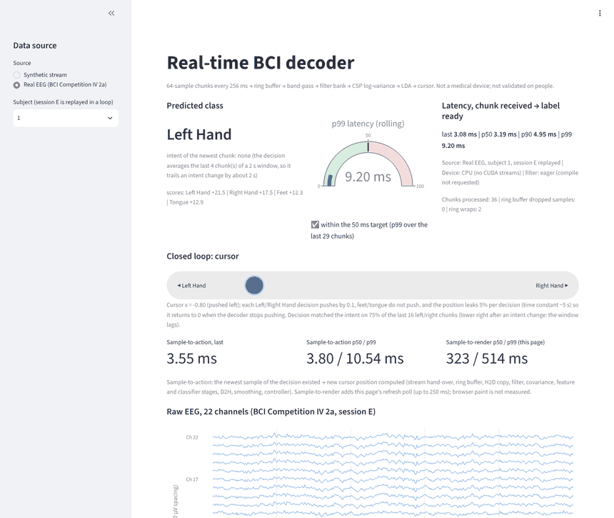
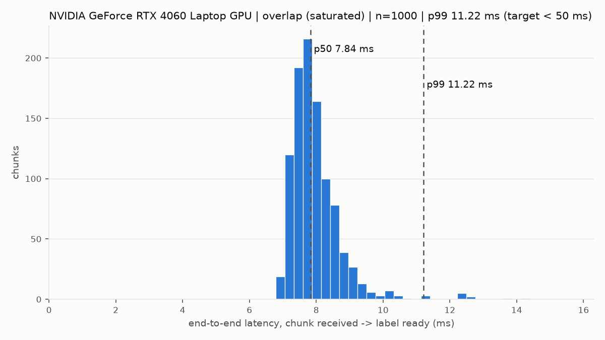
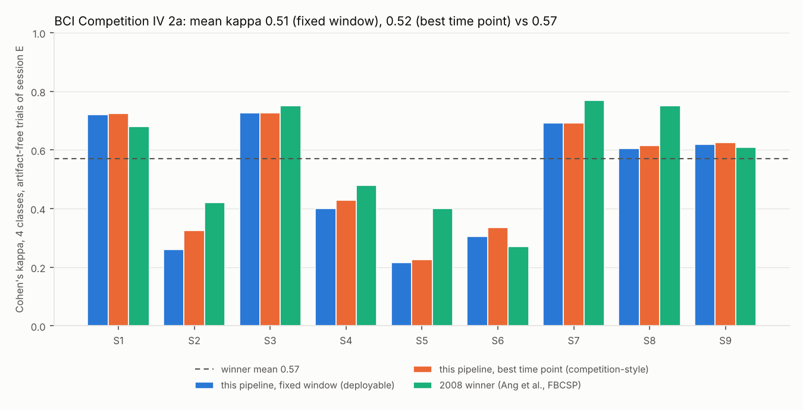
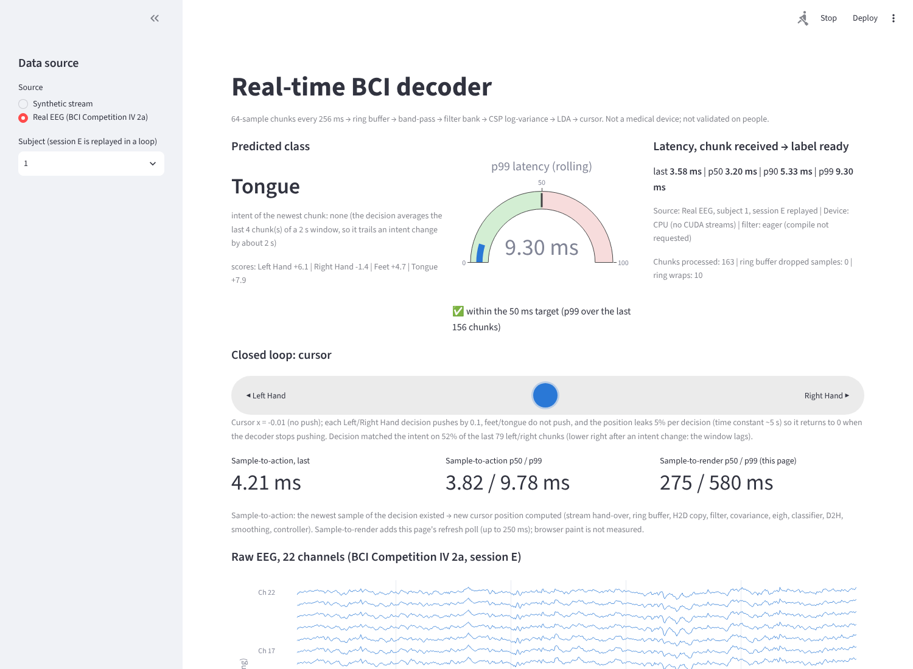

# realtime-bci

Real-time EEG decoding on a GPU. Chunks of 64 samples (256 ms at 250 Hz) go through a ring buffer into pinned
memory, then through two CUDA streams (band-pass filter, covariance, classifier). A Streamlit dashboard shows the
decoded class, a cursor that follows it, and the latency of every step.

It runs on a synthetic generator and on the public BCI Competition IV 2a motor-imagery recordings, replayed
directly or through Lab Streaming Layer (LSL). It has never run on a real amplifier or a live participant.



## Results

| | Result | Setup |
|---|---|---|
| End-to-end latency, 64 channels, synthetic, one chunk every 256 ms | p99 **23.4 ms** (target 50 ms) | RTX 4060 laptop, 1000 chunks |
| Real EEG over LSL, Riemannian decoder | median 4.1–7.3 ms, p99 6.5–26.0 ms over six runs; LSL jitter 0.05–0.08 ms | same laptop, 22 channels |
| 4-class Cohen's kappa, BCI Competition IV 2a, 9 subjects, train on session T, test on session E | **0.587** at a fixed window, **0.598** at the best time point | filter-bank CSP + LDA |

The 2008 competition winner scored 0.57. The difference here is +0.017 with a paired standard error of 0.018 over
the nine subjects, so this is a match, not a win. The comparison is also approximate: the competition scored a
sample-by-sample causal output, this project scores one decision per chunk from a 2 s window plus a 4-chunk mean.
Scores are on the experts' artifact-free trials, as in the competition. No artifact removal is applied and the EOG
channels are not used for decoding; with the flagged trials included kappa is 0.585 / 0.594.

<p>
  
  
</p>

Three things to know before quoting any of this:

* **The CUDA stream overlap did not reduce latency.** Copy and kernel overlap exists but is tiny (7 µs of an
  11 µs copy), and the look-ahead variant is slower than the plain baseline. The classifier stage, a float64
  `eigh` with a host sync, is about 75% of the compute time.
* **The real-data p99 moves between runs.** In three of six runs about 1–2% of chunks ran several times slower,
  in the classifier and covariance stages. A diagnostic run excluded Python garbage collection and the host
  enqueue as causes; the cause itself is open ([FINDINGS §10](FINDINGS.md)).
* **The filter-bank decoder has no GPU latency measurement yet.** Its accuracy is verified on the GPU
  (`results/real_gpu_fbcsp_accuracy/` is byte-identical to the CPU run apart from line endings), but the latency
  runs above were all made with the Riemannian decoder. Latency numbers come from one laptop with other
  applications open.

## Real EEG

| Decoder (9 subjects, 4 classes) | Accuracy | Kappa, fixed window | Kappa, best time point |
|---|---|---|---|
| **Filter-bank CSP + LDA, mean of the last 4 chunk scores (default)** | **0.690** | **0.587** | **0.598** |
| Riemannian tangent space + LDA, same smoothing | 0.629 | 0.505 | 0.523 |
| Riemannian + LDA, no smoothing | 0.592 | 0.456 | 0.510 |
| 2008 competition winner (Ang et al.) | | 0.57 | 0.57 |

The filter-bank decoder uses nine 4 Hz bands from 4 to 40 Hz, one-vs-rest CSP, 48 log-variance features chosen by
mutual information, and LDA. It was selected by leave-one-run-out cross-validation on session T only
(`python -m bci.real_benchmark select2`); session E was scored once per decoder. The second selection round was
started because the first decoder scored below 0.57 on session E, so session E influenced whether to try again,
though not which candidate won. Details and caveats are in [FINDINGS §9](FINDINGS.md).

## Closed loop

The dashboard moves a cursor with the decoded class. *Left Hand* pushes it by −0.1 and *Right Hand* by +0.1; other
classes do not push; the position leaks 5% per decision and is clipped at ±1. It also shows **sample-to-action
latency**: the time from the moment the newest sample of a decision existed (chunk complete) to the moment the new
cursor position is computed.



* On the RTX 4060, with the Riemannian decoder, sample-to-action was p50 7.6 ms, p90 9.4 ms, p99 19.2 ms (one
  180 s run). It has not been measured with the filter-bank decoder. The screenshot above is a CPU host.
* It excludes the decoding window: a label trails the participant's intent by about 2 s plus 0.4 s of smoothing delay.
* The cursor is a weak control signal. Replaying the decoder's session-E decisions, it is on the intended side
  about 60% of the time during left/right imagery (chance is about 50%), and at an edge on 7.4% of decisions.

## Quick start

On a machine with an NVIDIA GPU, install a CUDA build of PyTorch first. The default PyPI wheel on Windows is
CPU-only, and the GPU tests fail on purpose instead of skipping. The stack measured here was Windows, Python 3.13:

```powershell
pip install torch==2.10.0 --index-url https://download.pytorch.org/whl/cu128
pip install -e ".[dev]"
pip install "triton-windows<3.7"     # lets torch.compile run on Windows; otherwise the filter runs eagerly
python -m playwright install chromium
```

Keep the CUDA builds matched: `onnxruntime-gpu` 1.27+ is built for CUDA 13 and cannot load next to a CUDA 12.x
torch, so `pyproject.toml` pins the 1.21–1.26 series. On Linux, Triton ships with the CUDA torch wheels.

```bash
make install       # pip install -e ".[dev]" and the Chromium download
make test          # GPU tests fail without CUDA; use `make test REQUIRE_CUDA=0` on a CPU host
make benchmark     # overlap, baseline and paced runs, 1000 chunks each, about 6 min -> results/
make dashboard     # streamlit run app/dashboard.py
make profile       # torch.profiler trace and overlap analysis -> results/
make benchmark-real   # 9-subject accuracy, then real-data latency and LSL jitter (needs a GPU)
make test-real        # also runs the tests that download the dataset (about 80 MB per subject)
```

Without `make` (PowerShell):

```powershell
$env:BCI_REQUIRE_CUDA = "1"; python -m pytest -v -rs
python -m bci.gpu_pipeline benchmark --chunks 1000 --warmup 50 --runs overlap,baseline,paced --out-dir results
python -m bci.real_benchmark accuracy --subjects 1-9 --device cuda --decoder fbcsp --out-dir results\real_gpu_fbcsp_accuracy
python -m bci.real_benchmark latency --decoder fbcsp --out-dir results\real_gpu_fbcsp_latency
python -m streamlit run app\dashboard.py
```

Plug in AC power and close other GPU-heavy applications before benchmarking. The paced run takes about 4.5 minutes.

## How it works

```
stream --64x64 chunk--> RingBuffer (1000 x C, O(1) writes)
                            | latest 500 samples, copied into a pinned slot
                            v
copy stream:      H2D (non_blocking) -- event --+
compute stream:                                 +-> FIR band-pass -> covariance -> features -> LDA -- event --> D2H
                                                                                                              |
                                                                           label and scores in pinned memory <-+
```

* **Decoders.** The Riemannian one whitens the covariance with a reference matrix, takes the matrix logarithm
  through `torch.linalg.eigh` and feeds LDA. The filter-bank CSP one uses a nine-band FIR bank, CSP log-variances
  and LDA; it has no eigendecomposition and no host synchronisation.
* **Hot path.** No `.item()`, `.cuda()`, `.cpu()`, `.tolist()` or `print`; an AST test enforces it. With the
  Riemannian decoder one host synchronisation is unavoidable, the one inside `eigh`.
* **Look-ahead.** The host enqueues chunk N-1's filter and covariance kernels, stages chunk N (pinned copy and
  async H2D), then runs N-1's `eigh` and classifier. Slot reuse is guarded by CUDA events, not host syncs.
* **Precision.** TF32 is off. The filter runs in float32, covariance, `eigh` and LDA in float64. CUDA output matches
  scipy float64 to 1.2e-5 (the requirement was 1e-4).
* **Filter.** One `conv1d` over all channels (channels folded into the batch axis), `torch.compile`d when Triton
  is available, eager otherwise; the result files say which.
* **Dashboard.** The pipeline runs in its own process so Streamlit's rendering cannot stall it.
* **ONNX.** The Riemannian LDA head is exported and run in onnxruntime. `eigh` is not exportable, so the full
  model is not.

## Layout

```
src/bci/    stream.py ring_buffer.py filters.py classifier.py fbcsp.py gpu_pipeline.py closed_loop.py
            lsl_stream.py real_benchmark.py tail_diag.py server.py
app/        dashboard.py         Streamlit UI (Hugging Face Spaces entry point)
docs/       index.html, assets/  static project page (GitHub Pages, CNAME bci.filtree.in)
tests/      ring buffer, correctness (CPU vs CUDA), latency and hot-path guards, LSL, real data,
            closed loop, filter-bank CSP, tail diagnostic, dashboard, server
scripts/    run_benchmark.sh profile.py record_gif.py cursor_sim.py ui_contention.py
results/    benchmark_*.csv, profiler_*, figures, dashboard GIFs and screenshots
            real/             accuracy, kappa time courses, noise logs, selection tables, latency runs
            real_gpu_fbcsp_accuracy/   GPU run of the filter-bank decoder (raw files)
            logs/, gpu_run/   console logs and extra benchmark runs from the GPU laptop
```

Design decisions are in [SPEC.md](SPEC.md), measurements and what went wrong in [FINDINGS.md](FINDINGS.md), and
every claim with its status and evidence in [CLAIMS.md](CLAIMS.md).

## Deploying the dashboard

The front matter at the top of this file declares a Streamlit Space with `app/dashboard.py` as the entry point,
and `requirements.txt` lists the runtime dependencies (CPU torch). A free CPU Space runs the same pipeline on CPU
and says "Device: CPU" on the page. For a GPU Space, delete the first line of `requirements.txt`.

What has been checked: `requirements.txt` alone in a clean Python 3.13 virtual environment serves the dashboard,
and the `Dockerfile` builds unmodified and runs on CPU. A Space itself has not been created, and
`docker run --gpus all` and `docker-compose.yml` have not been run. The real-data source is hidden on a Space
because MOABB is not in `requirements.txt`.

## Limitations

The latency benchmark uses synthetic data. The real-data results replay one public dataset (9 subjects) with no
artifact removal. One laptop and one software stack were measured. The filter-bank decoder's latency on the GPU and
its sample-to-action are unmeasured. The cause of the slow-chunk tail is open. The cursor is a weak control signal.
`make` on Windows, a Linux GPU host and CUDA 13 are untested.
